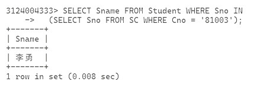
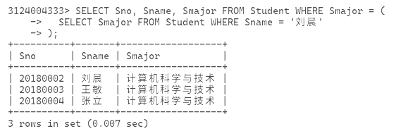
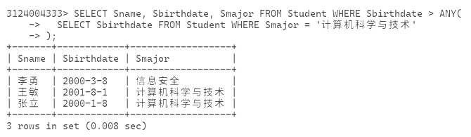
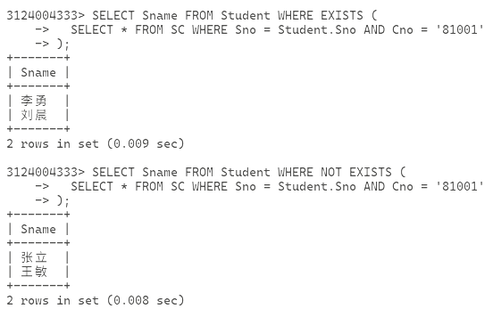

# 作业 10

1. 实验开始前将命令行窗口背景改为白色，字体改为黑色。
2. 修改提示符，包含自己的个人学学号信息。
3. 完成教材上SQL查询实验到例3.64部分。
4. 分析例3.64的执行过程
5. 实验使用md格式保存截图信息，如果MySQL执行SQL失败，给出失败原因。文件名为“作业10.md”

嵌套查询，个人理解有点类似于将对应的结果作为新查询的条件进行，用法上有点类似 bash 的 `$(cmd)`

```sql
SELECT Sname FROM Student WHERE Sno IN
  (SELECT Sno FROM SC WHERE Cno = '81003');
```

这里下面查到的 Sno 会作为上面 IN 的数组作为上面那个查询的条件进行



当然也可以用运算符

```sql
SELECT Sno, Sname, Smajor FROM Student WHERE Smajor = (
  SELECT Smajor FROM Student WHERE Sname = '刘晨'
);
```



这里出现了两个谓词 `ANY(array)` 和 `ALL(array)`，前者是任意，在前面具有运算符的时候是指运算关系与数组中某个值符合就行，而后者则是所有值都要符合

```sql
SELECT Sname, Sbirthdate, Smajor FROM Student WHERE Sbirthdate > ANY(
  SELECT Sbirthdate FROM Student WHERE Smajor = '计算机科学与技术'
);
```



`EXIST` 和 `NOT EXIST` 表示存在与不存在，使用 `EXIST` 时，当后面的运算结果为空则返回假，否则返回真，`NOT EXIST` 与 `EXIST` 相反

```sql
SELECT Sname FROM Student WHERE EXISTS (
  SELECT * FROM SC WHERE Sno = Student.Sno AND Cno = '81001'
);
SELECT Sname FROM Student WHERE NOT EXISTS (
  SELECT * FROM SC WHERE Sno = Student.Sno AND Cno = '81001'
);
```



