# 作业11

1. 第六版本教材第123页习题3第3，5，6，8题。 
2. 需要在纸张上答题并拍照，纸张上需要留有自己的信人信息。 照片压缩处理，单张照片文件大小不要超过1M。（也可以直接在手写板上做题） 
3. 继续实验：完成教材上第三章剩余SQL例子。
4. 分析例3.65的执行过程
5. 实验使用md格式保存截图信息，如果MySQL执行SQL失败，给出失败原因。
6. 作业文件名为“作业11.md”

## 书本题目

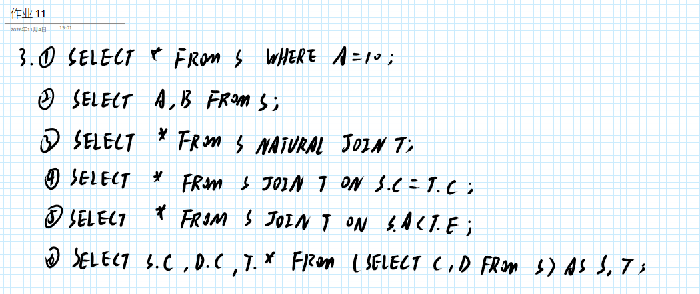

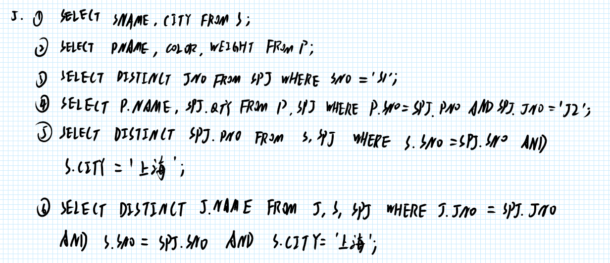

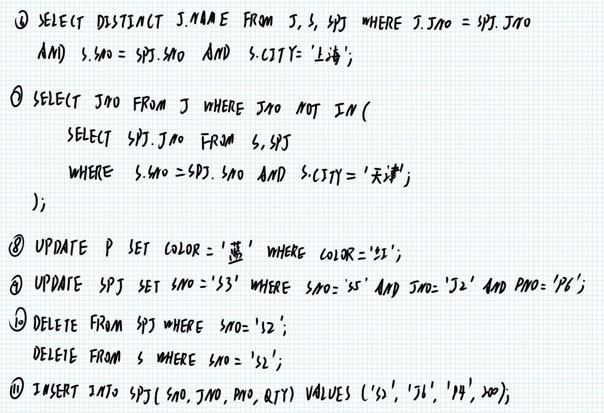

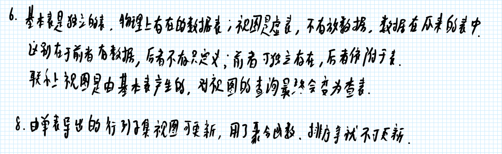

## 实验部分

使用 UNION 继续联合查询，但是要注意进行 UNION 的各个结果的列数要相同

```sql
(SELECT * FROM Student WHERE Smajor = '计算机科学与技术') UNION
(
  SELECT * FROM Student WHERE (
    EXTRACT(YEAR FROM CURRENT_DATE) - EXTRACT(YEAR FROM Sbirthdate)
  ) < 19
);
```

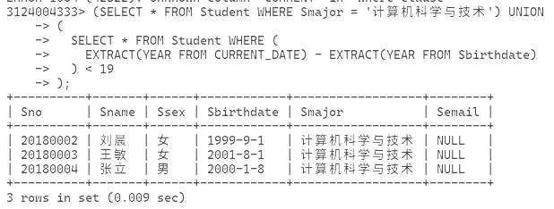

在派生表中查询，即将查询对象的结果作为一个临时表给到新的查询语句进行查询

```sql
SELECT Sno, Cno FROM SC, (
    SELECT Sno, AVG(Grade) FROM SC GROUP BY Sno
  ) AS Avg_SC(Avg_sno, Avg_grade) --+ 这里创建了临时的 Avg_SC 表格，且含有 Avg_sno 和 Avg_grade 列
WHERE SC.Sno = Avg_SC.Avg_sno AND SC.Grade >= Avg_SC.Avg_grade;
```

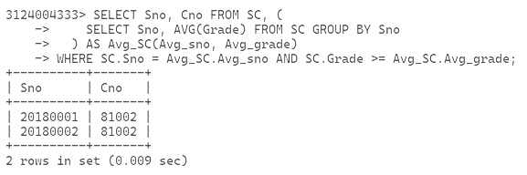

没有 AVG 之类的这种函数的时候，可以不用这么麻烦，沿用子查询的列名即可

```sql
SELECT Sname FROM Student, (
  SELECT Sno FROM SC WHERE Cno = '81001'
) AS SC1 WHERE Student.Sno = SC1.Sno;
```

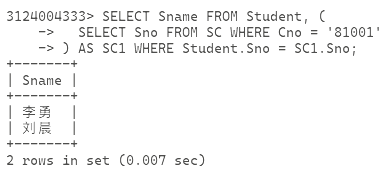

然后到数据更新这一节，插入很简单，上面也做过了

```sql
INSERT INTO Student (Sno, Sname, Ssex, Smajor, Sbirthdate) VALUES ('20180009', '陈冬', '男', '信息管理与信息系统', '2000-5-22');
--+ 上面等同于
INSERT INTO Student VALUES ('20180009', '陈冬', '男', '2000-5-22', '信息管理与信息系统', NULL);
```

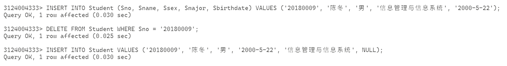

插入查询结果，即把查询结果作为需要插入的值丢入新表

```sql
CREATE TABLE Smajor_age (Smajor VARCHAR(20), Avg_age SMALLINT);
INSERT INTO Smajor_age(Smajor, Avg_age)
  SELECT Smajor, AVG(
    EXTRACT(YEAR FROM CURRENT_DATE) - EXTRACT(YEAR FROM Sbirthdate)
  ) FROM Student GROUP BY Smajor;
```

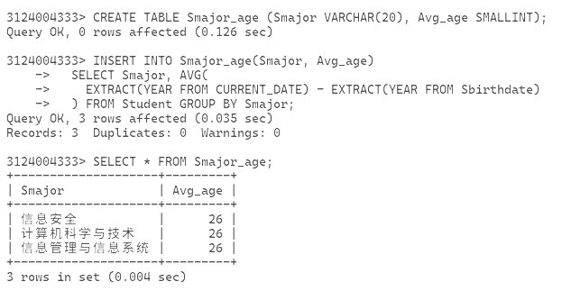

修改数据用 `UPDATE`

```sql
UPDATE Student SET Sbirthdate = '2001-3-18' WHERE Sno = '20180001';
UPDATE SC SET Grade = Grade + 5 WHERE Semester = '20201' AND Cno = '81002';
UPDATE SC SET Grade = 0 WHERE Sno IN (
  SELECT Sno FROM Student WHERE Smajor = '计算机科学与技术'
);
```

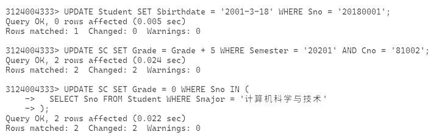

然后是删除，用 `DELETE` 就行

```sql
DELETE FROM Student WHERE Sno = '20180007';
DELETE FROM SC WHERE Sno IN (
  SELECT Sno FROM Student WHERE Smajor = '计算机科学与技术'
);
DELETE FROM SC;
```

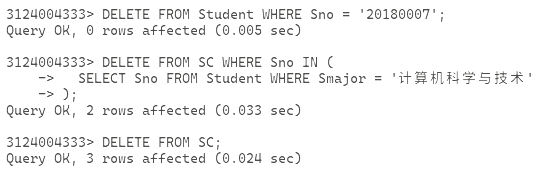

建立视图，使用 CREATE VIEW <name> [<col1>,<col2>...] AS <query> [WITH CHECK OPTION]

```sql
CREATE VIEW IS_Student AS SELECT Sno, Sname, Ssex, Sbirthdate, Smajor FROM STUDENT WHERE Smajor = '信息管理与信息系统' WITH CHECK OPTION;
```

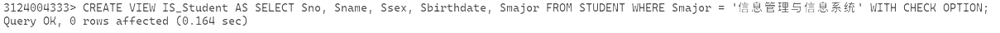

插入

```sql
INSERT INTO IS_Student VALUES ('20180010', '贾明', '男', '2001-11-1', '信息管理与信息系统');
INSERT INTO IS_Student VALUES ('20180011', '王伟', '男', '2003-11-1', '计算机科学与技术');
```

前面会成功，后面会失败，因为开了 `WITH CHECK OPTION`，而专业 `计算机科学与技术` 不满足原来的 `信息管理与信息系统`

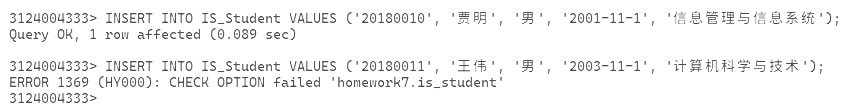

```sql
CREATE VIEW IS_C1(Sno, Sname, Grade) AS SELECT Student.Sno, Sname, Grade FROM Student, SC WHERE Smajor = '信息管理与信息系统' AND Student.Sno = SC.Sno AND SC.Cno = '81001';
CREATE VIEW IS_C2 AS SELECT Sno, Sname, Grade FROM IS_C1 WHERE Grade >= 90; 
CREATE VIEW S_AGE(Sno, Sname, Sage) AS SELECT Sno, Sname, (EXTRACT(YEAR FROM CURRENT_DATE) - EXTRACT(YEAR FROM Sbirthdate)) FROM Student;
CREATE VIEW S_GradeAVG(Sno, Gavg) AS SELECT Sno, AVG(Grade) FROM SC GROUP BY Sno;
CREATE VIEW F_Student(Fsno, Fname, Fsex, Fbirthdate, Fmajor) AS SELECT * FROM Student WHERE Ssex = '女';
```

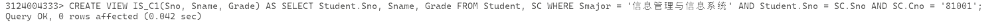

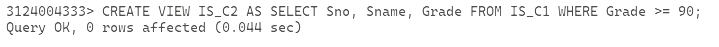

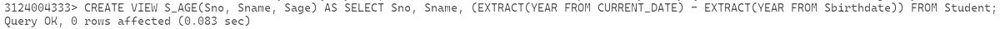

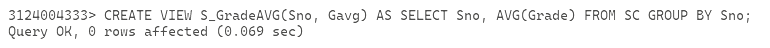

这里最后一个会炸，因为返回的列不止 5 列

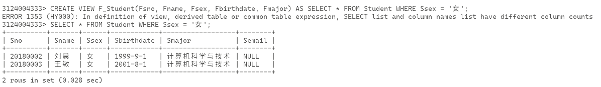

删除视图，用 DROP

```sql
DROP VIEW S_AGE;
DROP VIEW IS_C1;
```

这里删除 IS_C1 的时候没有报告错误，但是在查询的时候会炸，因为找不到

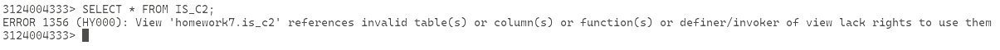

```sql
DROP VIEW IS_C2;
```

一起删了好了

查询视图跟查表没什么区别

```sql
SELECT IS_Student.Sno, Sname FROM IS_Student, SC WHERE IS_Student.Sno = SC.Sno AND SC.Cno = '81001';
SELECT Student.Sno, Sname FROM Student, SC WHERE Student.Sno = SC.Sno AND SC.Cno = '81001' AND Smajor = '信息管理与信息系统';
```

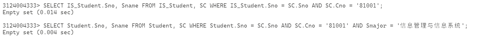

更新视图和更新表也是没啥区别

```sql
UPDATE IS_Student SET Sname = '刘新奇' WHERE Sno = '20180005' AND Smajor = '信息管理与信息系统';
INSERT INTO IS_Student VALUES('20180207','赵新','男','2001-0-7-19','信息管理与信息系统');
DELETE FROM IS_Student WHERE Sno = '20180207';
```

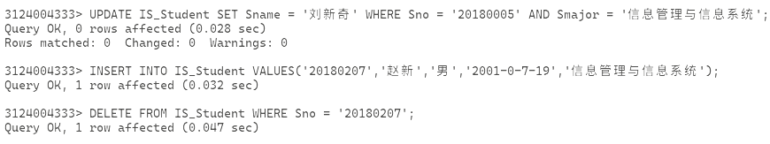

对于例子 3.65 有

先运行 SELECT * FROM SC SCY WHERE SCY.Sno = Student.Sno AND SCY.Cno = SCX.Cno，判断学生是否选择了 SCX.Cno

然后运行 SELECT * FROM SC SCX WHERE SCX.Sno = '20180002' AND NOT EXISTS (...) 查询是否存在学生学号为 20180002 的漏选课程

最后运行 SELECT Sno FROM Student WHERE NOT EXISTS (...) 查询是否有学号为 20180002 的学生选了，但是其他学生没选的课程
