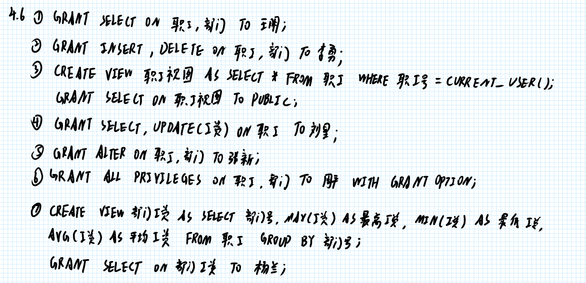
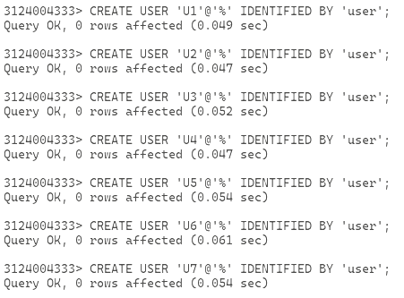
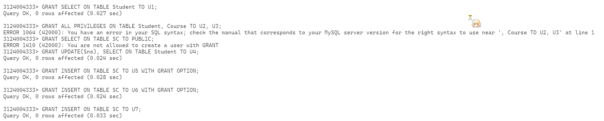
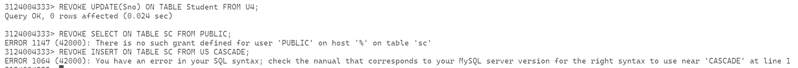
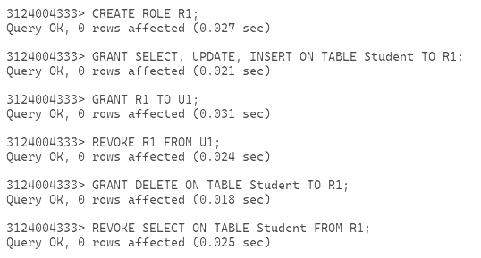
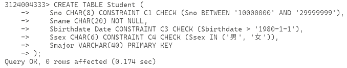
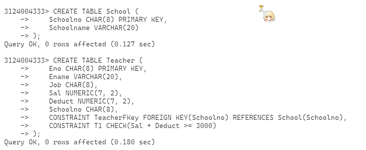

# 作业12

1. 解释说明下面术语
	1. 可更新的视图
	1. 不可更新的视图
	2. 不允许更新的视图
1. 完成第六版本教材习题4第5，6，10题。 
	2. 需要在纸张上答题并拍照，纸张上需要留有自己的信人信息。 照片压缩处理，单张照片文件大小不要超过1M。（也可以直接在手写板上做题） 
1. 完成第六版本教材习题5第7题。 
	2. 需要在纸张上答题并拍照，纸张上需要留有自己的信人信息。 照片压缩处理，单张照片文件大小不要超过1M。（也可以直接在手写板上做题） 
3. 继续实验：完成教材上第四章SQL例子。
3. 继续实验：完成教材上第五章第5，7节SQL例子。
5. 实验使用md格式保存截图信息，如果MySQL执行SQL失败，给出失败原因。
6. 作业文件名为“作业12.md”

## 解答





为了方便接下来的实验，这里先新建 7 个用户

```sql
CREATE USER 'U1'@'%' IDENTIFIED BY 'user';
CREATE USER 'U2'@'%' IDENTIFIED BY 'user';
CREATE USER 'U3'@'%' IDENTIFIED BY 'user';
CREATE USER 'U4'@'%' IDENTIFIED BY 'user';
CREATE USER 'U5'@'%' IDENTIFIED BY 'user';
CREATE USER 'U6'@'%' IDENTIFIED BY 'user';
CREATE USER 'U7'@'%' IDENTIFIED BY 'user';
```



授予权限

```sql
GRANT SELECT ON TABLE Student TO U1;
GRANT ALL PRIVILEGES ON TABLE Student, Course TO U2, U3;
GRANT SELECT ON TABLE SC TO PUBLIC;
GRANT UPDATE(Sno), SELECT ON TABLE Student TO U4;
GRANT INSERT ON TABLE SC TO U5 WITH GRANT OPTION;
GRANT INSERT ON TABLE SC TO U6 WITH GRANT OPTION;
GRANT INSERT ON TABLE SC TO U7;
```

第二个会炸，因为 MySQL 不允许在 GRANT 里面传入多个表

第三个也会炸，因为 Mysql 没有 PUBLIC 这个公共域关键词



撤回权限

```sql
REVOKE UPDATE(Sno) ON TABLE Student FROM U4;
REVOKE SELECT ON TABLE SC FROM PUBLIC;
REVOKE INSERT ON TABLE SC FROM U5 CASCADE;
```

第二个还是会炸，理由同上；第三个是因为 MySQL 中没有 CASCADE 关键字，但是回收默认以 CASCADE 进行



创建账户，但是现删掉之前建的

```sql
DROP USER IF EXISTS 'U1'@'%', 'U2'@'%', 'U3'@'%', 'U4'@'%', 'U5'@'%', 'U6'@'%', 'U7'@'%';
CREATE USER system2 WITH SUPERUSER PASSWORD '123456';
CREATE USER U1 WITH CREATEDB PASSWORD '123456';
CREATE USER U2 PASSWORD '123456';
```

这里后面三条都会报错，因为 MySQL 不支持这种写法，MySQL 的做法是

```sql
CREATE USER <name>@<host> IDENTIFIED BY <password>;
GRANT <permission> ON <database>.<table> TO <name>@<host>;
```

角色管理

```sql
CREATE ROLE R1;
GRANT SELECT, UPDATE, INSERT ON TABLE Student TO R1;
GRANT R1 TO U1;
REVOKE R1 FROM U1;
GRANT DELETE ON TABLE Student TO R1;
REVOKE SELECT ON TABLE Student FROM R1;
```




完整性约束，这里用一个新的数据库

```sql
CREATE TABLE Student (
    Sno CHAR(8) CONSTRAINT C1 CHECK (Sno BETWEEN '10000000' AND '29999999'),
    Sname CHAR(20) CONSTRAINT C2 NOT NULL,
    Sbirthdate Date CONSTRAINT C3 CHECK (Sbirthdate > '1980-1-1'),
    Ssex CHAR(6) CONSTRAINT C4 CHECK (Ssex IN ('男', '女')),
    Smajor VARCHAR(40) CONSTRAINT StudentKey PRIMARY KEY(Sno)
);
CREATE TABLE Teacher (
    Eno CHAR(8) PRIMARY KEY,
    Ename VARCHAR(20),
    Job CHAR(8),
    Sal NUMERIC(7, 2),
    Deduct NUMERIC(7, 2),
    Schoolno CHAR(8),
    CONSTRAINT TeacherFKey FOREIGN KEY(Schoolno) REFERENCES School(Schoolno),
    CONSTRAINT C1 CHECK(Sal + Deduct >= 3000)
);
ALTER TABLE Student DROP CONSTRAINT C3;
ALTER TABLE Student Drop CONSTRAINT C1;
ALTER TABLE Student ADD CONSTRAINT C1 CHECK (Sno BETWEEN '900000' AND '999999');
ALTER TABLE Student DROP CONSTRAINT C3;
ALTER TABLE Student ADD CONSTRAINT C3 CHECK (Sbirthdate > '1985-1-1');
```

这里应该全都会失败，因为 MySQL 不能对 NOT NULL 使用命名约束，且 PRIMARY KEY 也是不用命名约束

```sql
CREATE TABLE Student (
    Sno CHAR(8) CONSTRAINT C1 CHECK (Sno BETWEEN '10000000' AND '29999999'),
    Sname CHAR(20) NOT NULL,
    Sbirthdate Date CONSTRAINT C3 CHECK (Sbirthdate > '1980-1-1'),
    Ssex CHAR(6) CONSTRAINT C4 CHECK (Ssex IN ('男', '女')),
    Smajor VARCHAR(40) PRIMARY KEY
);
```



第二个建老师表的命令会失败是因为没有 School 表，外键引用找不到，而且这里有一个问题就是命名约束 C1 跟上面学生表的撞了

```sql
CREATE TABLE School (
    Schoolno CHAR(8) PRIMARY KEY,
    Schoolname VARCHAR(20)
);
CREATE TABLE Teacher (
    Eno CHAR(8) PRIMARY KEY,
    Ename VARCHAR(20),
    Job CHAR(8),
    Sal NUMERIC(7, 2),
    Deduct NUMERIC(7, 2),
    Schoolno CHAR(8),
    CONSTRAINT TeacherFKey FOREIGN KEY(Schoolno) REFERENCES School(Schoolno),
    CONSTRAINT T1 CHECK(Sal + Deduct >= 3000)
);
```

