# 作业 9

1. 实验开始前将命令行窗口背景改为白色，字体改为黑色。
2. 修改提示符，包含自己的个人学学号信息。
3. 完成教材上SQL查询实验到例3.55部分。
4. 使用MySQL语言提供的自然连接语法完成例3.52
5. 使用MySQL语言提供 `limit offset, row_count` 语法格式再次完成例3.50
6. 实验使用md格式保存截图信息，如果MySQL执行SQL失败，给出失败原因。文件名为“作业9.md”


查询出生月份大于 1 的学生，毕竟我这里的 YEAR 全都是 2000，分不开

```sql
SELECT * FROM Student WHERE EXTRACT(MONTH FROM Sbirthdate) > 1;
```

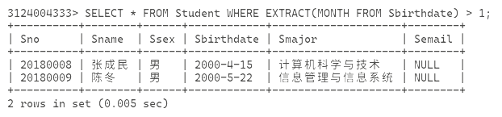

多条件查询，加多学号是 `20180008`

```sql
SELECT * FROM Student WHERE EXTRACT(MONTH FROM Sbirthdate) > 1 AND Sno = '20180008';
```

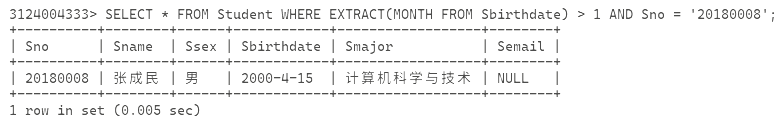

类似于 Python 的 `in list[]` 的这种判断条件，用 `IN` 可以查询在元组内的

```sql
SELECT * FROM Student WHERE Smajor IN ('计算机科学与技术', '信息管理与信息系统');
```

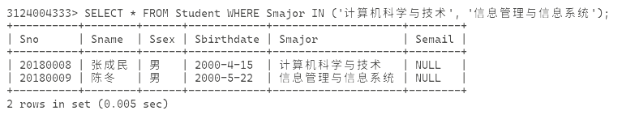

字符匹配查询，用 `%` 表示任意长度字符串，`_` 表示单个字符字符串，例如

```sql
SELECT * FROM Student WHERE Sname LIKE '张%';
SELECT * FROM Student WHERE Sname LIKE '陈_';
```

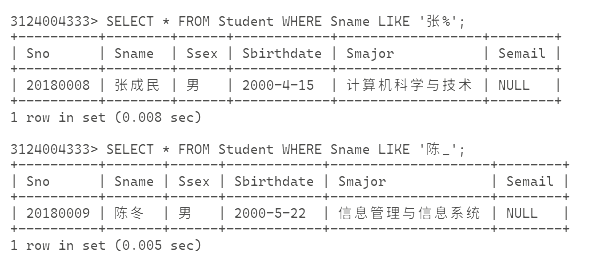

用 `ORDER BY` 排序

```sql
SELECT * FROM SC ORDER BY Sno DESC;
```

刚好对比一下有 ORDER 和没 ORDER

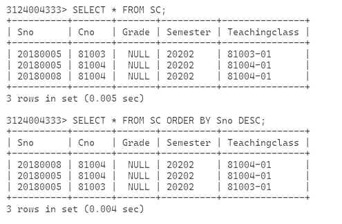

使用聚集函数（各种成型的计算函数）查询，这里其实没什么好算的，干脆就算一下总和吧

```sql
SELECT MAX(Ccredit) FROM Course;
SELECT SUM(Ccredit) FROM Course;
SELECT AVG(Ccredit) FROM Course;
```

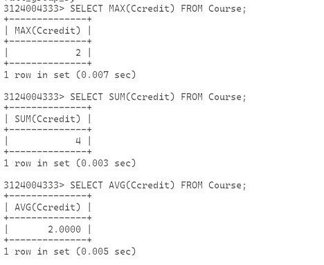

用 GROUP BY 分组

```sql
SELECT * FROM SC GROUP BY Cno;
```

这里会炸，因为 MySQL 认为这个写法太模糊了

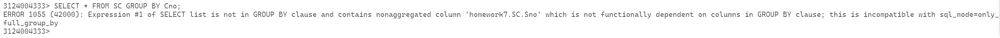

GROUP BY 的查询列只能出现依据的那一列和聚合函数，所以这里用 COUNT 试试

```sql
SELECT Cno, COUNT(*) FROM SC GROUP BY Cno;
```

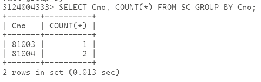

然后是使用 LIMIT 限制查询数量

```sql
SELECT * FROM SC LIMIT 2;
```

刚好上下对比一下

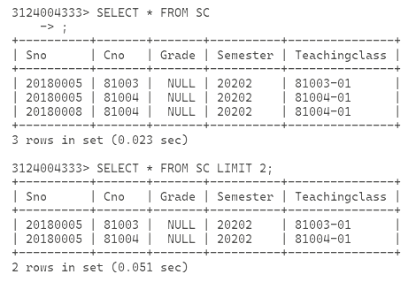

漏了一个筛选 HAVING，补一下

```sql
SELECT * FROM SC WHERE Sno = '20180005' HAVING Cno = '81003';
```

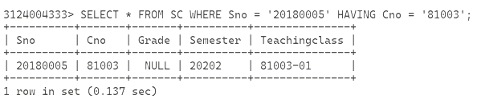

自然连接的跨表查询

```sql
SELECT * FROM Student, SC WHERE Student.Sno = SC.Sno;
```

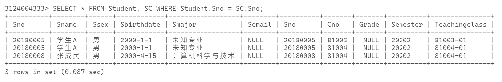

多条件跨表查询

```sql
SELECT * FROM Student, SC WHERE Student.Sno = SC.Sno AND Student.Smajor = '未知专业';
```

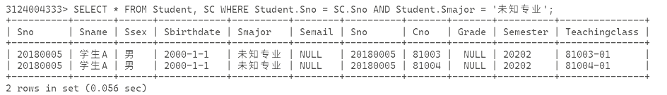

这里先按照书上的例子插入一下各个表的数据，不然下面进行不下去

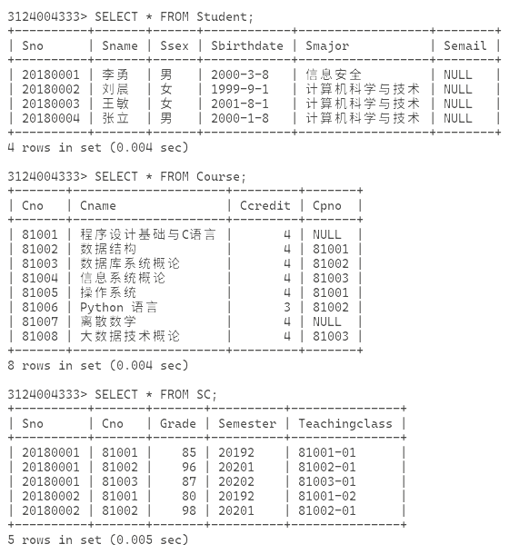

使用自身连接查询

```sql
SELECT FIRST.Cno, SECOND.Cpno FROM Course FIRST, COURSE SECOND WHERE FIRST.Cpno = SECOND.Cno and SECOND.Cpno IS NOT NULL;
```

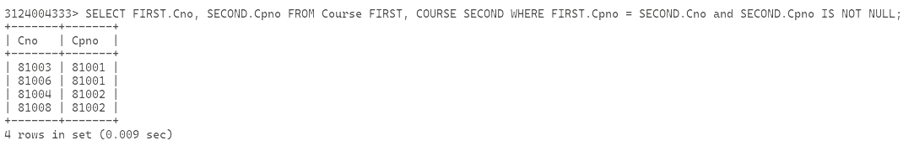

使用外连接查询相关信息，这里左右外连接是不一样的，`LEFT OUTER` 是列出满足关系的左表的元素，`RIGHT OUTER` 是列出满足关系的右表的元素

```sql
SELECT Student.Sno, Sname, Ssex, Sbirthdate, Smajor, Cno, Grade FROM Student LEFT OUTER JOIN SC ON Student.Sno = SC.Sno;  --+ 以 Student 表中的元素为主
SELECT Student.Sno, Sname, Ssex, Sbirthdate, Smajor, Cno, Grade FROM Student RIGHT OUTER JOIN SC ON Student.Sno = SC.Sno;  --+ 以 SC 表中的元素为主
```

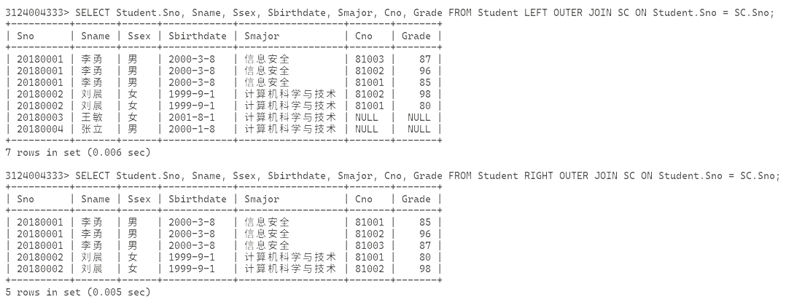

还可以使用多表连接查询，这个时候查询的时候如果列名相同要在前面带表名

```sql
SELECT Student.Sno, Sname, Cname, Grade FROM Student, SC, Course WHERE Student.Sno = SC.Sno AND SC.Cno = Course.Cno;
```

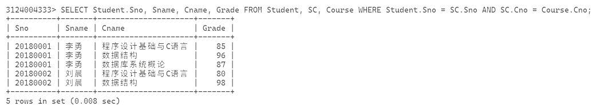

使用 `limit offset, row_count` 完成例 3.50

```sql
SELECT Sno, AVG(Grade) FROM SC GROUP BY Sno ORDER BY AVG(Grade) DESC LIMIT 5, 2;
```

~~忘截图了，后面还有删库的部分数据被我删了~~
