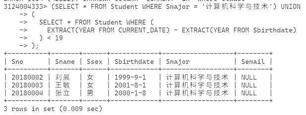
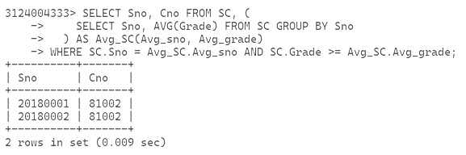
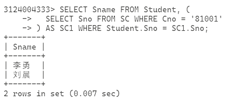
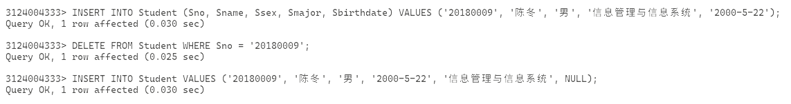
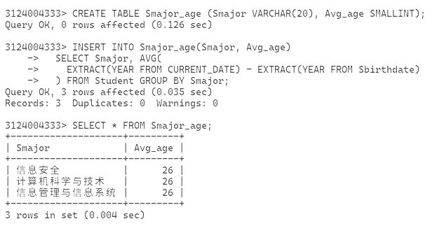
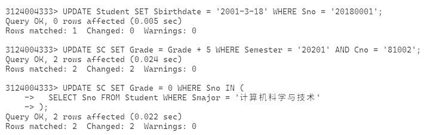
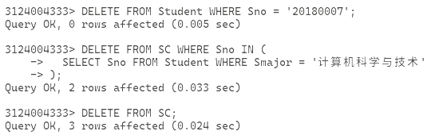

# 暂存用，前面做快了

使用 UNION 继续联合查询，但是要注意进行 UNION 的各个结果的列数要相同

```sql
(SELECT * FROM Student WHERE Smajor = '计算机科学与技术') UNION
(
  SELECT * FROM Student WHERE (
    EXTRACT(YEAR FROM CURRENT_DATE) - EXTRACT(YEAR FROM Sbirthdate)
  ) < 19
);
```



在派生表中查询，即将查询对象的结果作为一个临时表给到新的查询语句进行查询

```sql
SELECT Sno, Cno FROM SC, (
    SELECT Sno, AVG(Grade) FROM SC GROUP BY Sno
  ) AS Avg_SC(Avg_sno, Avg_grade) --+ 这里创建了临时的 Avg_SC 表格，且含有 Avg_sno 和 Avg_grade 列
WHERE SC.Sno = Avg_SC.Avg_sno AND SC.Grade >= Avg_SC.Avg_grade;
```



没有 AVG 之类的这种函数的时候，可以不用这么麻烦，沿用子查询的列名即可

```sql
SELECT Sname FROM Student, (
  SELECT Sno FROM SC WHERE Cno = '81001'
) AS SC1 WHERE Student.Sno = SC1.Sno;
```



然后到数据更新这一节，插入很简单，上面也做过了

```sql
INSERT INTO Student (Sno, Sname, Ssex, Smajor, Sbirthdate) VALUES ('20180009', '陈冬', '男', '信息管理与信息系统', '2000-5-22');
--+ 上面等同于
INSERT INTO Student VALUES ('20180009', '陈冬', '男', '2000-5-22', '信息管理与信息系统', NULL);
```



插入查询结果，即把查询结果作为需要插入的值丢入新表

```sql
CREATE TABLE Smajor_age (Smajor VARCHAR(20), Avg_age SMALLINT);
INSERT INTO Smajor_age(Smajor, Avg_age)
  SELECT Smajor, AVG(
    EXTRACT(YEAR FROM CURRENT_DATE) - EXTRACT(YEAR FROM Sbirthdate)
  ) FROM Student GROUP BY Smajor;
```



修改数据用 `UPDATE`

```sql
UPDATE Student SET Sbirthdate = '2001-3-18' WHERE Sno = '20180001';
UPDATE SC SET Grade = Grade + 5 WHERE Semester = '20201' AND Cno = '81002';
UPDATE SC SET Grade = 0 WHERE Sno IN (
  SELECT Sno FROM Student WHERE Smajor = '计算机科学与技术'
);
```



然后是删除，用 `DELETE` 就行

```sql
DELETE FROM Student WHERE Sno = '20180007';
DELETE FROM SC WHERE Sno IN (
  SELECT Sno FROM Student WHERE Smajor = '计算机科学与技术'
);
DELETE FROM SC;
```



